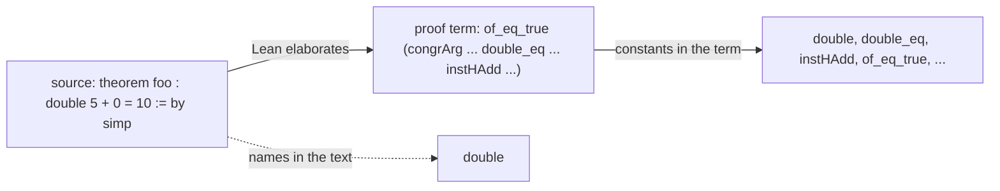
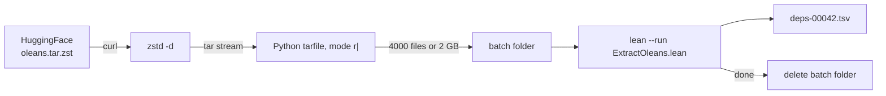
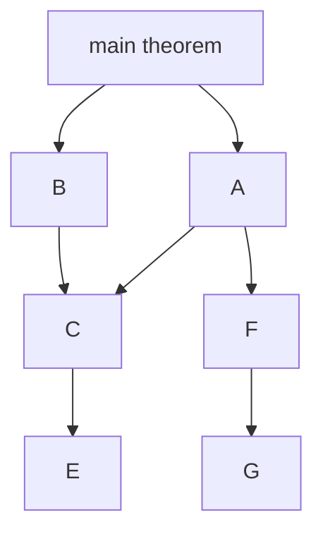
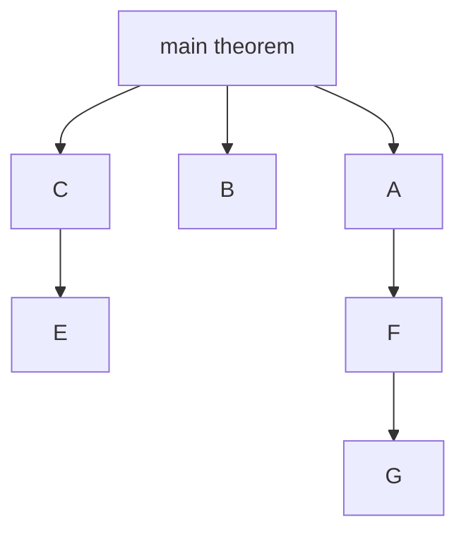

# How this project works

Three ideas carry the whole project. Each section has a picture, the reason it matters, and a small exercise you can run in a minute.

1. [Read proof terms, not source text](#1-read-proof-terms-not-source-text)
2. [Process 28 GB without unpacking it](#2-process-28-gb-without-unpacking-it)
3. [Dominator trees: who owns which part of the proof](#3-dominator-trees-who-owns-which-part-of-the-proof)

---

## 1. Read proof terms, not source text

### The problem

When Lean checks a proof, it turns your tactics into a **proof term**: one big expression that names every constant the proof really uses. The source text names far fewer things than that.



`simp` found `double_eq` on its own, and type class search found `instHAdd`. Neither name is written in the source. A tool that only reads text misses them.

### What happened in this project

| Method | Declarations reached from the main theorems |
|---|---|
| Names in the source (`indexer/index_lean.py`) | 167,091 |
| Constants in the proof terms (`extractor/ExtractOleans.lean`) | 794,719 |

Reading only the text missed about 80% of the real dependencies.

### How the extractor gets them

```lean
for ci in md.constants do                                   -- every constant in one .olean file
  let used := ci.type.getUsedConstants ++                   -- constants in its statement
    ((ci.value? (allowOpaque := true)).map (·.getUsedConstants)).getD #[]   -- and in its proof
```

`getUsedConstants` walks the expression tree and collects every constant name. Lean also creates helper constants (`foo.proof_1`, `foo.match_1`, equation lemmas). `userKey` folds those back into `foo`, so the graph shows the declarations people actually wrote.

### Try it

Make a tiny Lean project with this file, build it, and run the extractor on its `.olean` files:

```lean
@[simp] theorem double_eq (n : Nat) : 2 * n = n + n := by omega
theorem five : 2 * 5 = 5 + 5 := by simp
```

Check that `five` lists `double_eq` as a dependency, even though its source never mentions it.

---

## 2. Process 28 GB without unpacking it

### The problem

The compiled proof is a 28.6 GB `.tar.zst` archive. Unpacked it is well over 100 GB. A free GitHub runner has about 14 GB of disk, and the first attempt ran out of space at 40%.

### The idea: a stream with batches

A `.tar` file is just files laid end to end, and `zstd` can decompress a stream. So we never need the whole archive on disk:



Three things make this work:

1. **`tarfile.open(fileobj=stream, mode="r|")`.** The `|` means read once, front to back, with no seeking. That is all a pipe allows.
2. **Each `.olean` can be read alone.** `readModuleData` loads one compiled file without importing Mathlib or the other 175k files. That is why no full build is needed.
3. **A semaphore limits how many batches exist at once** (`jobs + 1`). If the extractor is slower than the download, the reader waits, so disk use stays bounded.

Result on GitHub's free runner: 175,187 files in about 20 minutes, using a few GB of disk.

### Try it

```python
import tarfile, io
buf = io.BytesIO()
with tarfile.open(fileobj=buf, mode="w") as t:          # make a small tar in memory
    for i in range(5):
        data = f"file {i}".encode()
        info = tarfile.TarInfo(f"f{i}.txt"); info.size = len(data)
        t.addfile(info, io.BytesIO(data))
buf.seek(0)
with tarfile.open(fileobj=buf, mode="r|") as t:          # read it as a stream
    for m in t:
        print(m.name, t.extractfile(m).read())
```

Now try calling `t.getmembers()` before the loop in stream mode and see why it fails: streams cannot go back.

---

## 3. Dominator trees: who owns which part of the proof

### The definition

Draw an arrow from each result to everything it uses. Start at the main theorem.

**D dominates X** when every path from the main theorem down to X passes through D.



- `A` dominates `F` and `G`: the only way down to them goes through `A`.
- `A` does not dominate `C`, because there is another way in through `B`. `C` is shared groundwork.
- So `A` "owns" `{A, F, G}`. That is the part of the proof that exists only to prove `A`.

Each node's closest dominator is its **immediate dominator**. Linking every node to it gives the **dominator tree**:



The icicle chart on the site is this tree, with each bar as wide as the number of declarations it owns.

### The algorithm (Cooper, Harvey and Kennedy, 2001)

```text
number every node in reverse postorder (a DFS from the root, reversed)
idom[root] = root
repeat until nothing changes:
  for each node v in reverse postorder, except the root:
    new = the first predecessor of v that already has an idom
    for each other predecessor p that has an idom:
      new = intersect(p, new)
    idom[v] = new

intersect(a, b):   # walk up the current tree until the two fingers meet
  while a != b:
    while postorder[a] < postorder[b]: a = idom[a]
    while postorder[b] < postorder[a]: b = idom[b]
  return a
```

Why it is fast: in reverse postorder, a node's predecessors are usually handled before it, so the answer settles in very few passes. On this proof (795k nodes, 12M edges) it took three passes and about 80 seconds in Python. See `indexer/dominators.py`.

Owned sizes then come from one more pass: walk the nodes in reverse and add each node's count to its immediate dominator's.

### Try it

```python
edges = {"RH": ["A", "B"], "A": ["C", "F"], "B": ["C"], "C": ["E"], "F": ["G"], "E": [], "G": []}
```

1. Work out the immediate dominator of every node by hand.
2. Implement the pseudocode above and check it against your answers.
3. Add an edge `B -> F`. Which owned sets change, and why?

---

## Where each idea lives in the code

| Idea | File |
|---|---|
| Proof-term dependencies | `extractor/ExtractOleans.lean` |
| Streaming the archive | `extractor/stream_extract.py` |
| Mapping names onto the source index | `indexer/exact_edges.py` |
| Dominator tree and owned sizes | `indexer/dominators.py` |
| Outline, literature, steps | `indexer/build_insights.py` |
